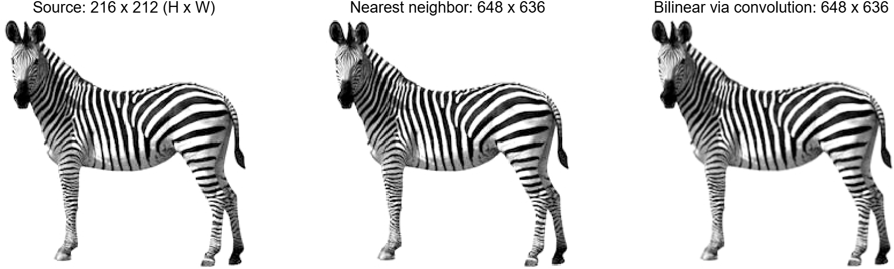

# 上采样：《信号与线性系统》工程设计题 6

用“插零 + 卷积”实现线性插值，推导 3 倍插值核，并把 `zebra.jpg` 的行、列各放大 3 倍（216×212 → 648×636，行×列）。

**一维插值核：** `f[n] = max(1 - |n|/3, 0)`，即 `n = -2:2` 上的 `[1/3, 2/3, 1, 2/3, 1/3]`。二维核是它的外积 `F[p,q] = f[p]f[q]`，用两次方向卷积实现。



## 运行

需要 MATLAB，不需要工具箱。已在 R2026a Update 5 上运行通过；`jsonencode` 的 `PrettyPrint` 选项和 `exportgraphics` 要求 R2021a 及以上。

1. 克隆或下载本仓库，保持文件在同一目录。
2. 在 MATLAB 中打开 `main_upsampling.m`，按 F5。
3. 命令窗口应显示 `16/16 tests PASS` 和 `ALL CHECKS PASSED`，结果写入 `results/`。

只跑测试：

```matlab
checks = test_upsampling();
```

## 文件

| 文件 | 内容 |
|---|---|
| `6.上采样.pdf` | 任务原文 |
| `zebra.jpg` | 输入图像 |
| `main_upsampling.m` | 主程序，生成全部图表、数值和验证记录 |
| `linear_upsample_1d.m` | 一维插零与完整卷积 |
| `bilinear_upsample_conv.m` | 二维插零与可分离卷积 |
| `test_upsampling.m` | 16 项数值验证 |
| `上采样实现说明.md` | 推导、代码逐行说明、结果和答辩要点 |
| `results/` | 运行结果，最终图像是 `zebra_3x_bilinear.png` |

重新运行会覆盖 `results/` 中的同名文件，即使数值没变，git 也会把其中大部分文件显示为已修改（PNG 的像素相同，文件字节不同）。没有改算法或绘图时，用 `git restore results` 撤销即可，不必提交。
