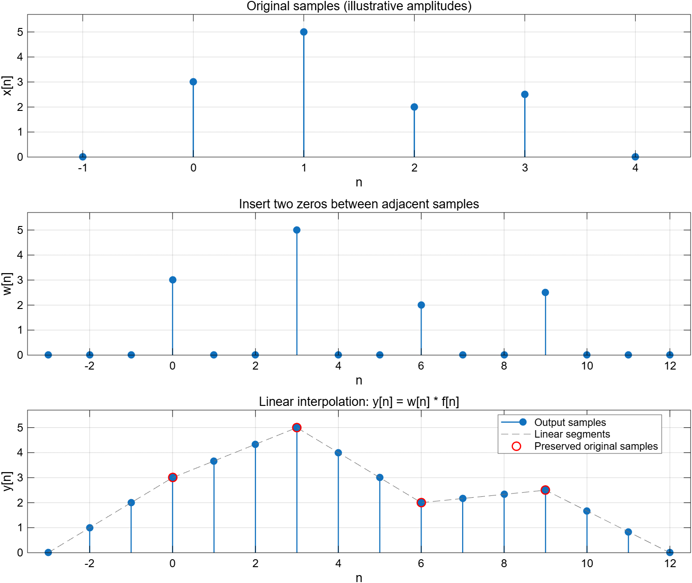
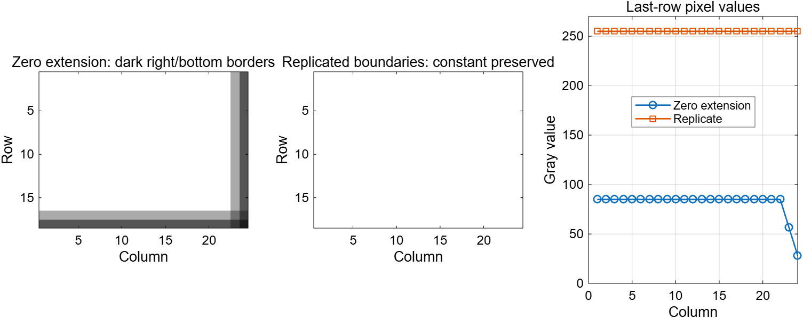
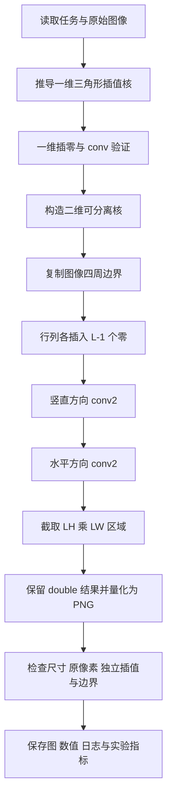
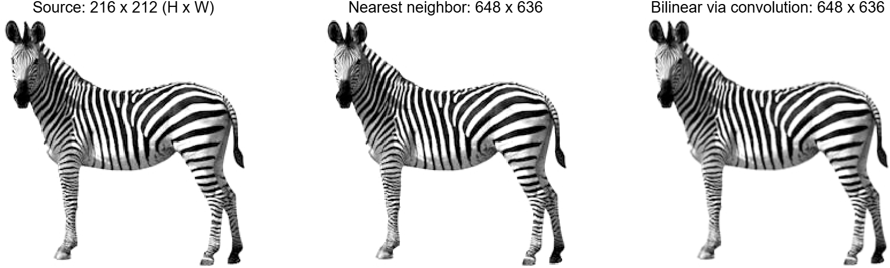
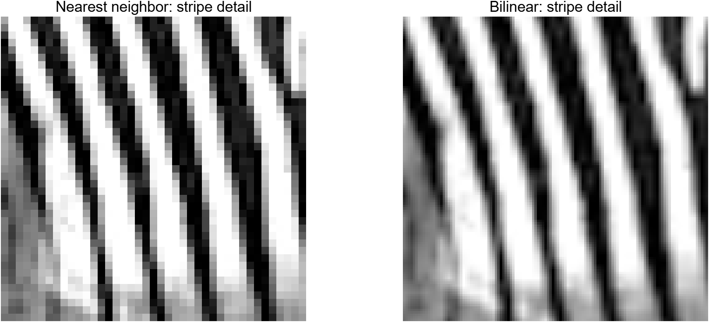
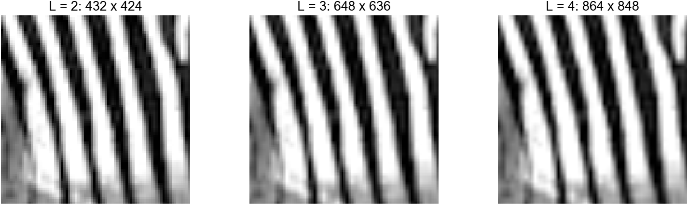
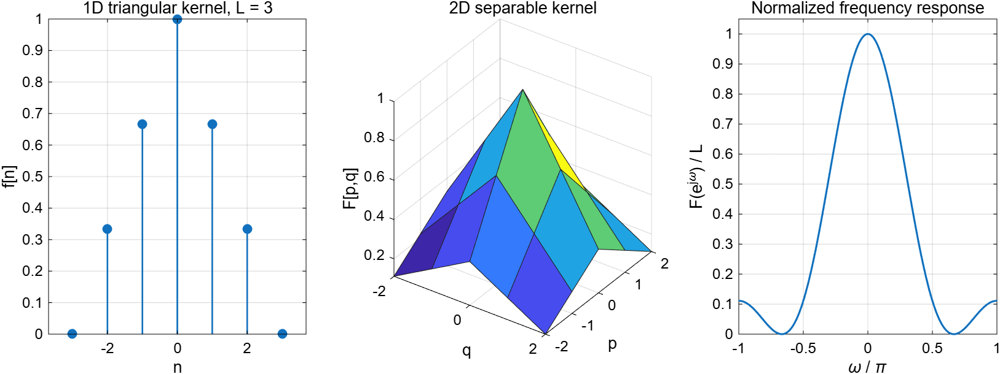

# 工程设计题6：上采样——实现原理、代码与操作说明

本项目完成了 `6.上采样.pdf` 中的两项任务：推导实现3倍线性插值的卷积核，并将题目提供的 `zebra.jpg` 在行、列两个方向各放大3倍。算法采用“插零 + 卷积”，没有用 `imresize` 代替题目要求的实现。

**先看结论：**

- 一维插值核为 `f = [1/3, 2/3, 1, 2/3, 1/3]`，对应数学下标 `n = -2:2`，即 `[-2,-1,0,1,2]`。
- 二维核是两个一维核的外积；先沿行方向插值，再沿列方向插值，得到双线性插值。
- 原图为 **216行 × 212列**，结果为 **648行 × 636列**。按图片“宽×高”的习惯写，就是 **212×216 → 636×648**。
- 已在本机 MATLAB R2026a Update 5 中实际运行，16项算法测试全部通过。实测指标见第8节及 `results/metrics.json`。
- 原始 PDF、原始 JPG 保留不变。运行脚本只会更新 `results` 内本项目生成的文件。

> 阅读顺序：想先操作，直接看第2节；想理解原理，先看第3～5节；想弄懂代码，看第6节；写报告或准备答辩，看第8～11节。

## 1. 任务范围与文件

### 1.1 题目要求

根据任务 PDF 第1页：

1. 一维序列 `x[n]` 在 `0≤n≤N` 内取样。每两个相邻样本之间插入两个零，得到 `w[n]`，要求确定卷积核 `f[n]`，使 `y[n]=w[n]*f[n]` 为线性插值后的序列。
2. 将这种方法扩展到二维，用程序把给定斑马图片放大3倍。

题目的一维图是示意图，**没有给出样本幅值的数值**。本项目选取 `x=[3,5,2,2.5]` 展示计算过程，不能在报告中称这些数值为题目原始数据。卷积核的推导适用于任意样本值，不依赖这组演示数值。

“放大3倍”在本项目中明确为：图像高度与宽度分别变成原来的3倍，因此总像素数变成原来的9倍。

### 1.2 文件结构

```text
工程设计题6. 上采样/
├─ 6.上采样.pdf                 原始任务，不修改
├─ zebra.jpg                   原始灰度图片，不修改
├─ main_upsampling.m            主程序：一键生成所有结果
├─ linear_upsample_1d.m         一维插零与完整卷积
├─ bilinear_upsample_conv.m     二维插零与可分离卷积
├─ test_upsampling.m            独立数值验证
├─ 上采样实现说明.md            本说明
└─ results/
   ├─ zebra_3x_bilinear.png     本题的3倍放大结果，PNG无损保存
   ├─ zebra_3x_nearest.png      最近邻放大对照
   ├─ 01_1d_upsampling.png      原序列、插零序列、插值结果
   ├─ 02_interpolation_kernel.png  一维核、二维核、频率响应
   ├─ 03_zebra_comparison.png   原图和两种放大方法对比
   ├─ 04_stripe_detail.png      条纹局部对比
   ├─ 05_boundary_validation.png   边界处理对比
   ├─ 06_scale_comparison.png   2、3、4倍插值对比
   ├─ 同名 .fig 文件           可在 MATLAB 中继续编辑的图窗
   ├─ one_dimensional_values.csv   一维结果数值
   ├─ scale_metrics.csv        不同倍数的尺寸、核增益和样本误差
   ├─ test_results.csv         每项算法测试的误差和通过状态
   ├─ metrics.json             本次运行的数值指标
   ├─ validation.txt           MATLAB运行与验证记录
   └─ experiment_data.mat      未量化的 double 结果及实验变量
```

**只需要基础 MATLAB。** 核心使用 `conv`、`conv2`，显示使用 `imagesc`，因此不依赖 Image Processing Toolbox 或 Signal Processing Toolbox。`interp1`、`interp2` 仅作为独立核对工具，没有参与生成最终插值图像。

## 2. 在 MATLAB 中手动完成的步骤

### 2.1 最直接的操作方法

1. 打开 MATLAB。
2. 找到“当前文件夹 / Current Folder”上方的路径栏，输入下面的文件夹地址并按回车：

   ```text
   D:\Users\inmu\Desktop\Uni\XXdzy\工程设计题6. 上采样
   ```

3. 在当前文件夹中双击 `main_upsampling.m`，在编辑器中打开它。
4. 检查 `zebra.jpg`、三个函数文件和主程序在同一个文件夹中。
5. 点击编辑器的绿色“运行 / Run”按钮，或按 **F5**。如果提示切换文件夹，选择切换到本文件所在文件夹。
6. 等待运行结束。会生成6幅图；命令窗口末尾应出现 `ALL CHECKS PASSED`，并显示 `216 x 212 → 648 x 636`，这里顺序是“行×列”。
7. 在当前文件夹中打开 `results`，查看 `zebra_3x_bilinear.png`。这张图是最终图像；`03_zebra_comparison.png` 是用于报告的对照图。
8. 若要复制到 Word 或 PPT，插入 `results` 中的 PNG。若要修改图例、坐标轴或布局，可在 MATLAB 中打开同名 `.fig`。

也可以在命令窗口输入：

```matlab
cd('D:\Users\inmu\Desktop\Uni\XXdzy\工程设计题6. 上采样');
main_upsampling
```

主程序会清空当前工作区变量并清理命令窗口。它不会删除原始文件；重复运行会覆盖同名生成结果和旧的验证日志。如果你改过代码并希望保留上一次实验结果，先复制 `results` 文件夹。

### 2.2 单独运行、观察与验证

只验证算法、不重新绘制所有图：

```matlab
checks = test_upsampling();
```

只看一维插值：

```matlab
x = [3 5 2 2.5];
[y, n, w, nw, f, nf] = linear_upsample_1d(x, 3);
stem(n, y, 'filled');
grid on;
```

只看斑马图放大：

```matlab
I = double(imread('zebra.jpg'));
Y = bilinear_upsample_conv(I, 3);
imagesc(Y, [0 255]);
colormap(gray(256));
axis image off;
size(Y)
```

`size(Y)` 应显示 `648 636`。检查原像素是否保留：

```matlab
originalSamples = Y(1:3:end, 1:3:end);
max(abs(originalSamples(:) - I(:)))
```

本次运行这个误差为0。这里比较的是 JPG **解码后的原始像素值**；本项目不能逆转 JPG 文件本身已经存在的压缩损失。

### 2.3 怎样自己做参数实验

- 改变一维序列：修改主程序的 `x = [3 5 2 2.5]` 中的四个幅值，观察插入样本如何跟随两端值变化。若幅值超出图中0～5.7范围，需相应调整 `ylim`；若要改变样本个数，优先直接调用一维函数并用 `stem(n,y)` 绘图。
- 改变放大倍数：直接调用 `bilinear_upsample_conv(I, 2)` 或 `bilinear_upsample_conv(I, 4)`。主程序已自动比较2、3、4倍。**最终作业输出保持3倍**；不要只改主程序的 `L`，因为输出文件名和题目展示文字按3倍命名。
- 换图验证：函数支持灰度和RGB，但主程序的对照图与局部截取针对老师提供的斑马灰度图设计。如果改成小图或彩色图，需同步修改主程序的灰度检查和 `roiRows/roiCols`；不要修改老师的原图。

## 3. 一维原理：插零为什么还不够

### 3.1 原序列与3倍插零

设原序列的数学下标从0开始：

\[
x[0],x[1],\ldots,x[N].
\]

插零以后，原样本的位置改为 `0,3,6,…,3N`：

\[
w[n]=
\begin{cases}
x[n/3],&n=0,3,6,\ldots,3N,\\
0,&\text{其他}.
\end{cases}
\]

以演示序列为例：

```text
x = [3, 5, 2, 2.5]
w = [3, 0, 0, 5, 0, 0, 2, 0, 0, 2.5]
```

新插入的零只是为新采样位置留出空间，还不是正确的插值结果。如果把二维插零数组直接当作图片显示，图片中会充满黑点；因此还必须做后续卷积。

### 3.2 线性插值要求什么数值

设相邻两个原样本为 `a=x[k]`、`b=x[k+1]`。在放大后的坐标中，它们位于 `3k` 与 `3k+3`，中间两个样本应均匀地落在线段上：

\[
\begin{aligned}
y[3k]&=a,\\
y[3k+1]&=\frac23a+\frac13b,\\
y[3k+2]&=\frac13a+\frac23b,\\
y[3k+3]&=b.
\end{aligned}
\]

例如从3到5，应依次为：

\[
3,\quad 3+\frac{5-3}{3}=\frac{11}{3},\quad
3+\frac{2(5-3)}{3}=\frac{13}{3},\quad5.
\]

重点是权重：越靠近左样本，左样本的权重越大；两边权重之和始终为1。

### 3.3 怎样从卷积推导三角形核

把插零序列写成离散冲激的加权和：

\[
w[n]=\sum_{k=0}^{N}x[k]\delta[n-3k].
\]

根据卷积的移位性质：

\[
y[n]=w[n]*f[n]=\sum_{k=0}^{N}x[k]f[n-3k].
\]

这表示：每个原样本产生一个移到自身位置、乘以自身幅值的插值核，所有核叠加形成结果。为了保留原样本并得到上述权重，核需要满足：

\[
f[0]=1,\quad f[\pm1]=\frac23,\quad
f[\pm2]=\frac13,\quad f[n]=0\ (|n|\ge3).
\]

所以本题答案为：

\[
\boxed{f[n]=\max\left(1-\frac{|n|}{3},0\right)}.
\]

| 数学下标 n | -3 | -2 | -1 | 0 | 1 | 2 | 3 |
|---|---:|---:|---:|---:|---:|---:|---:|
| f[n] | 0 | 1/3 | 2/3 | 1 | 2/3 | 1/3 | 0 |

MATLAB 卷积时只需存储非零部分：

```matlab
nf = -2:2;
f = [1/3 2/3 1 2/3 1/3];
y = conv(w, f);
```

代入 `n=3k+1`，只有相邻两个样本有贡献：

\[
y[3k+1]=x[k]f[1]+x[k+1]f[-2]
=\frac23x[k]+\frac13x[k+1].
\]

同理得到 `y[3k+2]`。在 `n=3k` 处，邻近核已到零点，因此 `y[3k]=x[k]`，原始样本被准确保留。

### 3.4 推广到任意整数 L 倍

\[
f_L[n]=\max\left(1-\frac{|n|}{L},0\right).
\]

当 `n=Lk+r`、`0≤r≤L` 时：

\[
y[Lk+r]=\left(1-\frac rL\right)x[k]+\frac rLx[k+1].
\]

实现代码：

```matlab
nf = -(L-1):(L-1);
f = 1 - abs(nf)/L;
```

**不能再把 `f` 除以 `sum(f)`。** 该核的系数和为 `L`，本题为3。插零将样本在新网格中的密度降为原来的 `1/L`，核的增益用于补偿这种变化。若误写为 `f=f/sum(f)`，一维原样本会变成原来的 `1/3`；二维同时沿两个方向这样处理，像素会变成原来的 `1/9`。

### 3.5 为什么卷积结果有负下标

`w` 的非零范围是 `0…3N`，`f` 的非零范围是 `-2…2`，因此完整卷积的范围是：

\[
-2\le n\le3N+2.
\]

演示中 `N=3`，因此 `conv` 返回14个数，对应 `n=-2…11`。**`y(1)` 表示的是 `y[-2]`，不是 `y[0]`。** `conv` 只计算数组值，不知道数学下标，必须自己建立下标向量。

本题一维有限序列以外按0处理。所以在原样本的两端，输出分别线性过渡到 `n=-3` 与 `n=12` 处的零。绘图额外画出这两个零点，以解释题目示意图中的端部过渡。

完整演示结果为：

| n | -2 | -1 | 0 | 1 | 2 | 3 | 4 | 5 | 6 | 7 | 8 | 9 | 10 | 11 |
|---|---:|---:|---:|---:|---:|---:|---:|---:|---:|---:|---:|---:|---:|---:|
| y[n] | 1 | 2 | 3 | 11/3 | 13/3 | 5 | 4 | 3 | 2 | 13/6 | 7/3 | 5/2 | 5/3 | 5/6 |



## 4. 二维原理：双线性插值与可分离卷积

### 4.1 把图像看作二维离散信号

灰度图是一张矩阵，`I[i,j]` 表示第 `i` 行、第 `j` 列的灰度值。图像在上下方向和左右方向各有一个离散坐标。

3倍插零后：

\[
W[p,q]=\sum_i\sum_j I[i,j]\delta[p-3i]\delta[q-3j].
\]

原像素放到行、列下标都为3的整数倍的位置，其余位置填0。

### 4.2 二维核为什么是外积

沿两个方向分别应用同一个一维核，得到：

\[
\boxed{F[p,q]=f[p]f[q]},\qquad
Y=W*_{2D}F.
\]

本题二维核为：

\[
F=\frac19
\begin{bmatrix}
1&2&3&2&1\\
2&4&6&4&2\\
3&6&9&6&3\\
2&4&6&4&2\\
1&2&3&2&1
\end{bmatrix}.
\]

行、列数学下标都为 `-2…2`，中心系数为1，总系数和为9。

因为核可分离，直接使用5×5核做二维卷积，与先用5×1核再用1×5核的结果相同：

```matlab
T = conv2(Z, f(:), 'same');
T = conv2(T, f(:).', 'same');
```

前一行在竖直方向插值，后一行在水平方向插值。两个方向的处理顺序也可以互换。对于长度为 `K=2L-1` 的核，直接二维卷积每个输出位置大约涉及 `K²` 个系数；可分离形式大约涉及 `2K` 个系数。本题 `K=5`，理论系数运算量由25降至10；这不是本机运行时间必然缩短2.5倍的测量结论。

### 4.3 四个相邻像素的权重

在原图坐标 `(i+α,j+β)`，其中 `0≤α,β≤1`，结果为：

\[
\begin{aligned}
Y={}&(1-\alpha)(1-\beta)I[i,j]
 +(1-\alpha)\beta I[i,j+1]\\
 &+\alpha(1-\beta)I[i+1,j]
 +\alpha\beta I[i+1,j+1].
\end{aligned}
\]

这里 `α` 表示竖直位置的比例，`β` 表示水平位置的比例。四个系数都非负，且总和为1，因此新像素位于四个相邻像素的最小值与最大值之间，理论上不会产生过冲。

例如四个像素是：

```text
0    30
60   90
```

在 `α=β=1/3` 处：

\[
Y=\frac49\cdot0+\frac29\cdot30+\frac29\cdot60+\frac19\cdot90=30.
\]

程序通过卷积得到相同值，这就是一维思想在二维的扩展。

## 5. 两个必须说明的实现约定

### 5.1 原像素对齐与精确3倍尺寸

本项目采用“原点对齐”的网格。数学下标从0开始时：

\[
Y[Li,Lj]=I[i,j].
\]

换成 MATLAB 从1开始的数组下标：

```matlab
Y(1:L:end, 1:L:end) == I
```

等式在浮点计算中允许极小舍入误差。对老师提供的图片，本次实测误差为0。

对输出的第 `r` 行、第 `c` 列，先映射回原图坐标：

\[
u=(r-1)/L,\qquad v=(c-1)/L.
\]

如果只在原图首、末采样点之间插值，输出尺寸会是：

\[
((H-1)L+1)\times((W-1)L+1),
\]

本题将得到646×634，而不是要求的648×636。本项目采用 **`LH×LW`** 输出，最后多出的 `L-1` 行、列通过边界复制定义。这样既明确了3倍尺寸，也保留了原像素网格。

使用其他软件的双线性放大时，若采用像素中心对齐等不同坐标规则，可能与本图存在细微差异。因此比较算法必须使用**相同的坐标和边界约定**。本项目的独立参考正是按上述坐标生成，不直接拿其他默认放大规则的结果判定错误。

### 5.2 为什么图像边界不能直接按0处理

对一维题目，有限序列以外为0，正是题意中的端部过渡；但图像的外部若直接补0，相当于把外部设成黑色，会使边缘亮度下降。因此二维图像选择复制边界像素，而不是继承一维示意图的零延拓。

以原图 `I` 为例，先生成边界扩展数组：

```matlab
rows = [1, 1:H, H];
cols = [1, 1:W, W];
P = I(rows, cols);
```

`rows` 里第一行出现两次，最后一行也出现两次；`cols` 同理。因此 `P` 比原图上下各多一行、左右各多一列，新增像素取最近的边界值。

扩展后的第2个源样本就是原图第1个样本。插零后，它位于 MATLAB 的 `L+1` 位置。卷积后从这里开始截取：

```matlab
outRows = L + (1:L*H);
outCols = L + (1:L*W);
Y = T(outRows, outCols);
```

当 `L=3` 时，从第4行、第4列开始保留648行、636列。原点前的填充只用于边界定义，输出最后两个子像素仍能获得复制的边界样本参与插值。



白色常量图在任何放大位置都应保持255。图中不做边界扩展的方案右侧、下侧变暗；复制边界后全图保持白色。这项测试可以发现“主体看起来正确，但边界处理错误”的情况。

## 6. 代码怎样写出来：核心语句逐行解释

### 6.1 一维函数 `linear_upsample_1d.m`

函数调用：

```matlab
[y, n, w, nw, f, nf] = linear_upsample_1d(x, L);
```

六个输出分别为：结果值、结果数学下标、插零值、插零数学下标、核系数、核数学下标。

| 语句 | 函数或语法作用 | 为什么这样写 |
|---|---|---|
| `x = double(x(:).');` | `double` 转浮点；`(:)` 拉成列；`.'` 转置成行 | 统一输入形状，保留复数样本而不取共轭 |
| `N = length(x)-1;` | `length` 得到元素数 | 数学下标从0开始，4个元素最后下标为3 |
| `nw = 0:L*N;` | 冒号生成连续整数 | 插零序列的坐标是0到 `LN` |
| `w = zeros(1,L*N+1);` | `zeros` 创建零数组 | 在原样本之间预留新位置 |
| `w(1:L:end) = x;` | 每隔 `L` 个数组位置赋值，`end` 为最后位置 | MATLAB位置1、4、7、10对应数学下标0、3、6、9 |
| `nf = -(L-1):(L-1);` | 生成核坐标 | 三角形核的非零范围 |
| `f = 1-abs(nf)/L;` | `abs` 取绝对值 | 直接对应推导的三角形公式 |
| `y = conv(w,f);` | `conv` 求完整离散线性卷积 | 各样本的移位三角形核相加，实现插值 |
| `n = (nw(1)+nf(1)):(nw(end)+nf(end));` | 卷积输出起、止下标等于输入起、止下标分别相加 | 处理负下标，避免把结果错误地右移2格 |

函数开头的 `validateattributes` 检查输入是否为有限数值向量、倍数是否为正整数。这些是防止错误输入的工程检查，不是插值公式的一部分。

若只想先理解最短版本，可以在命令窗口逐行执行：

```matlab
x = [3 5 2 2.5];
w = zeros(1, 10);
w(1:3:end) = x;
f = [1/3 2/3 1 2/3 1/3];
y = conv(w, f);
n = -2:11;
stem(n, y, 'filled');
grid on;
```

理解这8行后，再看项目函数中对任意长度、任意倍数的推广。

### 6.2 二维函数 `bilinear_upsample_conv.m`

| 语句 | 作用及原理 |
|---|---|
| `I = double(I);` | 灰度图通常是 `uint8`；先转成浮点，才能保留插值产生的小数 |
| `[H,W,C] = size(I);` | 获取行数、列数、通道数；灰度图 `C=1` |
| `nf = -(L-1):(L-1);` | 核的数学坐标 |
| `f = 1-abs(nf)/L;` | 与一维任务相同的三角形核 |
| `Y = zeros(L*H,L*W,C);` | 预先分配精确放大尺寸 |
| `rows=[1,1:H,H]`、`cols=[1,1:W,W]` | 指定复制边界的源坐标 |
| `for c = 1:C` | 逐通道处理，不把RGB通道混在一起卷积 |
| `P = I(rows,cols,c);` | 得到扩展后的单通道图像 |
| `Z = zeros(L*(H+1)+1,L*(W+1)+1);` | `P` 尺寸为 `(H+2)×(W+2)`，首末样本之间共有 `H+1`、`W+1` 个间隔，插零长度按“间隔数×L+1”计算 |
| `Z(1:L:end,1:L:end)=P;` | 二维插零：只在每隔 `L` 行、每隔 `L` 列的交点放入源样本 |
| `T=conv2(Z,f(:),'same');` | `f(:)` 是列核；`conv2` 沿竖直方向插值；`'same'` 保留与 `Z` 相同尺寸的中心部分 |
| `T=conv2(T,f(:).','same');` | 非共轭转置成行核，再沿水平方向插值 |
| `Y(:,:,c)=T(outRows,outCols);` | 截取原点对齐的最终区域，去掉仅用于计算的扩展区域 |

注意这里的 `conv2` 两次都使用奇数长度且中心对称的核，因此 `'same'` 截取的中心与核的 `n=0` 对齐。一维需要展示完整端部过渡，所以使用完整 `conv`；二维先扩展再截取，所以使用 `'same'`。

### 6.3 主程序与常用函数

`main_upsampling.m` 按5个阶段组织：一维演示 → 核分析 → 图像放大与对比 → 算法验证与参数实验 → 保存数值。

| 函数/语法 | 在本项目中的作用 |
|---|---|
| `mfilename('fullpath')`、`fileparts` | 找到主程序自身的文件夹，不依赖从哪里点击运行 |
| `fullfile` | 正确组合路径 |
| `addpath` | 让 MATLAB 找到同文件夹中的函数文件 |
| `mkdir` | 第一次运行时创建结果文件夹 |
| `imread` | 把 `zebra.jpg` 解码为像素矩阵 |
| `kron(I,ones(L))` | 将每个像素复制成 `L×L` 方块，形成最近邻对照 |
| `uint8`、`round` | 保存前才转换为8位整数，避免过程中逐步舍入 |
| `imwrite` | 保存最终 PNG，不重新用 JPG 压缩插值结果 |
| `figure`、`subplot` | 建立图窗及多个子图 |
| `stem` | 画离散序列的杆状图 |
| `plot` | 画线段、频率响应和边界曲线 |
| `imagesc(A,[0 255])` | 显示图像，并统一灰度范围，避免对比图各自拉伸亮度 |
| `colormap(gray(256))` | 使用256级灰度色表 |
| `axis image off` | 行、列单位保持同样长度并隐藏图像坐标轴 |
| `f(:)*f(:).'` | 列向量乘行向量，生成二维外积核；这里使用矩阵乘法 |
| `exp(-1j*nf(:)*omega)` | 根据DTFT定义构建复指数项；`1j` 明确表示虚数单位 |
| `meshgrid` | 构建独立参考所需的二维查询坐标 |
| `interp1`、`interp2` | 与手动卷积结果对照，检验一维线性和二维双线性插值 |
| `assert` | 条件不满足时立即报错，阻止把错误结果当成成功 |
| `tic`、`toc` | 测量一次核心放大调用的时间，不包括读图、绘图和写文件 |
| `exportgraphics`、`savefig` | 保存报告用PNG及可编辑图窗 |
| `save`、`writetable`、`jsonencode` | 分别保存MAT变量、CSV表格、JSON指标 |
| `diary` | 记录命令窗口输出，便于老师或组员复核 |

末尾的局部函数 `save_light_figure` 统一白底黑字并保存图窗。这是显示与文件输出辅助代码，不影响数值算法。

## 7. 程序流程与实现过程



如果 Markdown 查看器不支持 Mermaid，按下面顺序理解即可：**输入 → 定义核 → 扩展边界 → 插零 → 两次卷积 → 截取 → 验证 → 保存**。

实际设计思路是先解决一维，再扩展到二维：

1. 不从图像放大函数开始，而是从线性插值的两个权重推导核。
2. 用小序列手算，检查卷积的数值和下标，确定核中心与输出坐标。
3. 将一维核作外积，利用可分离性减少运算。
4. 先规定输出尺寸、坐标对齐和边界行为，再写数组长度与截取位置。
5. 使用老师提供的真实图片运行，保存未量化结果与可编辑图窗。
6. 用手算样本、常量、平面、单行/单列、RGB、独立插值函数等检查算法，不能只凭“图片看起来像斑马”认定正确。

## 8. 运行结果与验证

### 8.1 最终图片与观察





最终图像见 [zebra_3x_bilinear.png](results/zebra_3x_bilinear.png)。对照图将三张图显示为相近的物理大小，便于比较视觉效果；实际文件的像素尺寸仍分别为216×212与648×636。

最近邻将一个像素复制成3×3方块，局部条纹边缘有明显阶梯。双线性插值在黑、白像素之间加入中间灰度，局部过渡较平滑，但锐利边缘也会变软。这是方法的预期特性，不能称为恢复了不存在的真实细节。

### 8.2 本次实测指标

以下数据来自实际 MATLAB 运行及 `results/metrics.json`，误差单位为灰度级（范围0～255），不是归一化到0～1后的数值。

<!-- VERIFIED_METRICS_START -->
| 指标 | 实测结果 | 意义 |
|---|---:|---|
| 输入尺寸（行×列） | 216×212 | 使用老师提供的灰度 JPG |
| 输出尺寸（行×列） | 648×636 | 两个方向各3倍 |
| 原像素最大绝对误差 | 0 | `Y(1:3:end,1:3:end)` 与输入一致 |
| 与独立 `interp2` 的最大绝对误差 | 3.6664×10⁻¹² | 同一坐标与边界约定下的浮点误差 |
| 与独立 `interp2` 的RMSE | 2.69966×10⁻¹³ | 不是与真实高清图像比较 |
| 保存8位PNG的最大量化误差 | 0.444444 | 小于半个灰度级 |
| 零延拓白色图的最大误差 | 226.666667 | 不处理边界会明显变暗 |
| 复制边界白色图的最大误差 | 8.52651×10⁻¹⁴ | 边界和内部均保持常量 |
| 浮点输出最小值/最大值 | 0 / 255.00000000000009 | 超出255的约10⁻¹³量级属于舍入误差 |
| 独立算法测试 | 16/16通过 | 容限为10⁻¹⁰灰度级 |
<!-- VERIFIED_METRICS_END -->

核心调用的时间也记录在 `metrics.json` 的 `convolution_elapsed_seconds` 字段。它是本机单次测量，受启动、缓存与机器状态影响，不作为不同算法性能优劣的基准。

程序检查输出尺寸、独立参考误差、原样本保持和PNG量化误差。独立测试还包括：一维手算、`interp1` 对照、二维2×2手算、常量图、1～4倍插值、仿射平面、单像素、单行、单列、RGB通道、完整二维核与可分离核对照，以及棋盘格不产生过冲。

`test_results.csv` 的16行逐项记录验证结果；`validation.txt` 记录运行结束信息。验证对象主要是未量化的 `double` 数组，最终保存为PNG时只发生一次8位量化。

### 8.3 倍数的影响

| L | 输出尺寸（行×列） | 一维核系数和 | 原样本最大误差 |
|---:|---:|---:|---:|
| 2 | 432×424 | 2 | 0 |
| 3 | 648×636 | 3 | 0 |
| 4 | 864×848 | 4 | 0 |



倍数增大使每对源像素之间有更多中间样本，总像素数按 `L²` 增加。在相同显示范围下，变化主要是插值网格密度；黑白过渡的位置与基本形状仍由源图决定。不能据此宣称4倍比3倍“信息更多”或“真实分辨率更高”。

### 8.4 为什么不写PSNR或“高清恢复误差”

本任务只有低分辨率斑马图，没有对应的真实高清图。因此不存在可直接用于比较的648×636真实目标，不能凭空给出PSNR、SSIM或“恢复准确率”。这里的 `interp2` 误差只证明手动卷积实现了指定的双线性插值，**不证明插值结果等于真实高清图**。

## 9. 与《信号与系统》课程知识的联系

### 9.1 冲激分解、卷积与线性时不变系统

输入可分解为一组移位冲激，每个冲激经过插值滤波器后产生移位的 `f[n]`。卷积把这些响应相加。因而“三角形核”就是**插零之后的线性时不变滤波器**的单位冲激响应。

需要区分两个阶段：在高采样率网格上，与固定 `f[n]` 卷积是线性时不变运算；“先改变采样率再卷积”的整个多采样率系统，不能不加限定地直接称为同一网格上的时不变系统。原序列移位1个样本，会对应到输出移位 `L` 个样本。

### 9.2 频域解释

插零满足：

\[
W(e^{j\omega})=X(e^{jL\omega}).
\]

原频谱在新频率坐标下压缩，并在一个周期中出现多个副本。插值滤波器通过低通型响应抑制插零引入的频谱镜像。

长度为 `L` 的全1序列与其反转序列卷积，可以得到三角形序列；除以 `L` 后就是本项目的 `f_L`。因此其DTFT为：

\[
\mathcal{F}_L(e^{j\omega})=
\frac1L\left(\frac{\sin(L\omega/2)}{\sin(\omega/2)}\right)^2,
\]

在 `ω=0` 处取极限，值为 `L`。这与前面“不将系数和归一化为1”的结论一致。

本题 `L=3` 时：

\[
\mathcal{F}_3(e^{j\omega})
=1+\frac43\cos\omega+\frac23\cos2\omega.
\]



频率响应图画的是 `𝓕₃/3`，只为方便观察把直流值显示为1；**计算图像时使用的核并没有除以3**。三角形核并非理想砖墙低通，在通带内会有幅度衰减，也不能完全消除所有镜像，所以它是简单的近似内插，而不是理想带限重建。

### 9.3 教材位置

核对了用户提供的《信号与系统（第二版）》扫描PDF：

- **第7.2节，书内第336～337页（PDF第359～360页）**：从样本重建与内插、线性插值、移位插值函数叠加，以及理想带限内插与简单近似的区别。
- **第7.5.2节，书内第353～356页（PDF第376～379页）**：离散时间抽取与内插；第355页解释插入零样本后滤波的增采样过程，第356页图7.37给出相应框图与频谱。

本项目的三角形核由题目要求的线性权重推导，二维外积、坐标与边界处理是本项目的实现说明。不要把这些工程选择写成教材指定的唯一实现。

## 10. 局限、易错点与排查

### 10.1 方法局限

- 双线性插值简单且便于解释，但会柔化边缘，不能创造真实纹理。
- 只适用于这里的整数倍网格；函数没有实现任意小数倍缩放或下采样抗混叠设计。
- 图像复制边界是假设图外取最近的边界值，适合本题的放大展示，但不是对图外真实场景的估计。
- 插零再卷积需要分配较大的数组；本题小图运行轻便，特别大的图片或很大的 `L` 会增加内存开销。更高效的工业实现可直接按四邻域权重计算或采用多相结构。
- 数学上中心核含负下标，适合离线处理。若实时系统需要因果实现，可将核向右移 `L-1` 个样本，并补偿相应延迟。

### 10.2 常见问题

| 现象 | 原因 | 解决方法 |
|---|---|---|
| MATLAB 找不到函数 | 只复制了主程序，没有放置函数文件 | 将四个 `.m` 文件放在同一文件夹，运行主程序 |
| 提示找不到 `zebra.jpg` | 图片没在主程序所在文件夹 | 保留原文件名并放回同目录 |
| 图像整体很暗 | 错误地将插值核归一化为1，或把插零图当最终图 | 保持核和为3；必须完成两个方向的卷积 |
| 右侧/下侧变暗 | 忘记复制边界 | 使用项目函数，不直接对未扩展的数组做同尺寸卷积 |
| 输出是646×634 | 只插值首末原采样点之间的区间 | 明确3倍尺寸为648×636，按项目定义复制末边界 |
| 一维图像似乎整体右移2格 | 将 `conv` 数组位置当作数学下标 | 使用返回的 `n=-2:11` 作横坐标 |
| 图片看起来没有变大 | 查看器把不同分辨率图片缩放到同样窗口大小 | 看实际像素尺寸，而非只看屏幕占用面积 |
| 输出略大于255 | 浮点舍入误差，例如255.00000000000009 | 检查误差量级；PNG保存前裁剪并量化 |
| `exportgraphics` 不可用 | MATLAB 版本较旧 | 本项目在R2026a验证；旧版可将保存PNG语句替换为 `print`，算法本身仍使用基础卷积 |
| Markdown 公式或流程图没显示 | 查看器不支持数学公式/Mermaid | 使用支持数学渲染的查看器；流程的纯文字说明仍完整可读 |

## 11. 怎样整理成课程报告与答辩

本文件提供已运行的技术内容。文件夹上一级的 `工程设计作业报告-参考模板-集成.docx` 可用于最终课程报告排版；其示例内容不能直接当作本项目的实验结论。

| 模板栏目 | 本项目可使用的材料 |
|---|---|
| 问题描述 | 第1节，说明一维核推导与二维3倍图像放大 |
| 原理分析与设计思路 | 第3～5节及第9节，强调卷积、插值权重、可分离性 |
| 数学模型 | `w[n]`、`f[n]`、`F[p,q]`、四像素权重与坐标约定 |
| 编程思路 | 第6～7节与四个MATLAB文件 |
| 主要流程图及说明 | 第7节流程；若模板要求Word可编辑流程图，应按该结构用Word形状重画 |
| 结果分析 | 第8节、6幅PNG、真实误差和不同倍数对比 |
| 组内互评 | 由实际成员根据真实分工填写，本项目不虚构姓名、贡献或评分 |
| 总结与体会 | 可以围绕卷积下标、核增益、边界、验证方法和插值局限写本人的体会 |
| 参考文献 | 下列任务PDF与教材位置；若另查资料，再添加真实来源 |
| 附录主要代码 | 一维、二维核心函数及主程序的关键部分 |

组号、姓名、学号、指导教师、实际完成时间、分工与互评尚无用户提供的信息，应由你们组补充。任务页的“供题教师”不要未经确认就等同于报告的“指导教师”。

答辩可按这条顺序讲：**题目要求 → 插零为何不足 → 两个线性权重 → 三角形核 → 二维外积 → 边界与尺寸 → 真实运行结果 → 方法局限**。

常见提问及要点：

1. **为什么核和为3？** 因为插零降低新网格上的样本密度，插值滤波器需保持原样本与常量，不应按普通平滑核归一化到1。
2. **为什么能两次一维卷积代替二维卷积？** 因为二维核是 `f[p]f[q]`，具有可分离性。
3. **双线性插值用了几个源像素？** 在普通内部位置最多四个，权重非负、总和为1；在原样本或边界位置可退化为更少的不同源像素。
4. **图变大了，细节就恢复了吗？** 没有。新增像素来自邻近样本的加权，不能凭空增加真实信息。
5. **如何证明代码正确？** 手算小样本、原样本保持、常量与边界、仿射平面、独立 `interp1/interp2` 参考和完整二维核对照共同验证。

## 参考资料

1. 张敏明供题：《上采样》，用户提供的 `6.上采样.pdf`，第1页。
2. A. V. Oppenheim、A. S. Willsky、S. H. Nawab：《信号与系统（第二版）》，用户提供的中文扫描PDF，第7.2节与第7.5.2节，具体页码见第9.3节。
3. 本项目实际运行记录：`results/validation.txt`、`results/metrics.json`、`results/test_results.csv`；它们属于实验记录，不是外部文献。
